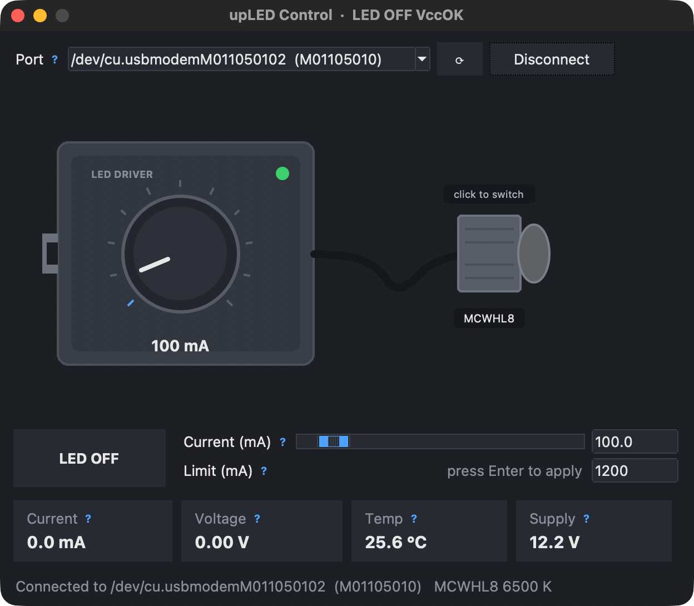

# pyupled

Cross-platform Python driver and small desktop app for the **Thorlabs upLED** USB LED
driver, on Linux, macOS and Windows. It talks to the device's USB serial port directly,
so you don't need the Thorlabs DLL, VISA or any vendor software.

> Written with AI assistance (Claude); protocol verified on real hardware.

<p align="center">
  
</p>

- **Small:** one module, only `pyserial` as a dependency.
- **Simple API:** `led.set_current(0.1)`, `led.on()`, `led.measure_voltage()`, ...
- **Finds the device itself** by its USB ID, or you pass the port or serial number.
- **Optional GUI** (`pyupled-gui`), using Tk from the standard library.

## Install

```bash
pip install .
```

## Quick start

```python
from pyupled import UpLed

print(UpLed.find())             # [(port, serial_number), ...]

with UpLed() as led:            # auto-finds the single attached upLED
    led.set_current_limit(0.5)  # A
    led.set_current(0.1)        # A
    led.on()
    print(led.measure_current(), led.measure_voltage(), led.measure_temperature())
    led.off()

led = UpLed("/dev/ttyACM0")     # or UpLed("COM3"), UpLed(serial_number="M01105010")
led.disconnect()
```

Units are SI: A, V, deg C, nm.

| Area | Methods |
|---|---|
| Output | `on()`, `off()`, `set_output(bool)`, `get_output()` |
| Current | `set_current`, `get_current`, `get_current_min/max`, `set_current_limit`, `get_current_limit(_max)`, `set_startup_current`, `get_startup_current` |
| Measure | `measure_current`, `measure_voltage`, `measure_temperature`, `measure_supply_voltage`, `measure_potentiometer` |
| Info | `identify()`, `led_info()`, `get_op_mode()`, `get_state()` |
| Config | `set/get_switch_on_at_startup`, `set/get_switch_off_at_disconnect`, `set/get_non_thorlabs_led`, `set/get_current_source`, `save_to_nvmem` |
| Raw | `query(cmd)`, `write(cmd)` (see [PROTOCOL.md](PROTOCOL.md)) |

Good to know:

- **Errors:** device errors raise `UpLedError` (its `.code` is the device's error code). A missing reply raises `UpLedTimeout`. No device found raises `LookupError`.
- **Current control:** `set_current` takes over from the knob on the device; you don't need to change any setting first.
- **Reading the setpoint:** `get_current()` reads 0 while the output is off.
- **White LEDs:** `led_info().wavelength` is negative for white LEDs. Its absolute value is the colour temperature in K.

## GUI

```bash
pyupled-gui              # after pip install .
python -m pyupled_gui    # or straight from the repo
```

- **Set the current:** drag or scroll the knob, click or drag the bar, or type a value in mA and press Enter.
- **Switch the LED:** click the LED head or the big button.
- **Help:** hover a **?** to see what each field means.
- **Demo:** pick **Demo** as the port to try the app without hardware.

The LED glow follows the measured current, and its colour is taken from the LED head. Wavelength LEDs glow in their colour; white LEDs glow in their colour temperature.

Tk ships with most Python installs. On Debian or Ubuntu run `sudo apt install python3-tk`. With Homebrew Python run `brew install python-tk`.

## Platform notes

| OS | Port | Notes |
|---|---|---|
| Linux | `/dev/ttyACM*` | add your user to `dialout` (`uucp` on Arch), then log in again |
| macOS | `/dev/cu.usbmodem*` | works out of the box |
| Windows | `COMx` | the built-in USB serial driver is enough |

Tested on upLED firmware 1.3.5 (macOS).

## Development

```bash
python -m unittest -v test_pyupled   # no hardware needed
```

[PROTOCOL.md](PROTOCOL.md) documents the wire protocol: commands, reply format, error
codes and the hardware-verified quirks.

## License

MIT, see [LICENSE](LICENSE). Not affiliated with or endorsed by Thorlabs. "Thorlabs" and
"upLED" are their trademarks. The app's drawing is a generic, stylized LED driver.
The protocol was worked out from the vendor's Windows driver and checked against a real
device.
